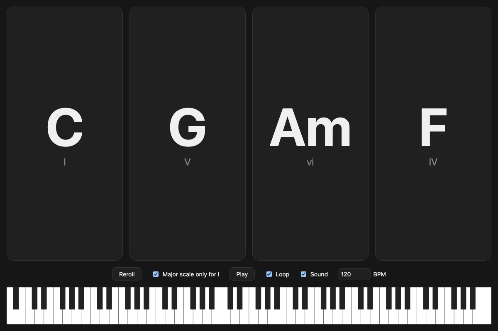

# chordgen

A I–V–vi–IV chord progression generator with piano diagrams, inversions, octaves and playback.



## Features

- **Random progressions**: reroll to get the I–V–vi–IV progression in a new key.
- **Piano diagrams**: click a chord to see its voicing on a keyboard.
- **Inversions and octaves**: step each chord through its inversions and octaves independently.
- **Full piano preview**: hover or adjust a chord to see it light up across all 88 keys.
- **Playback**: play the progression with sound, loop it and set the tempo (BPM).

## Getting started

```sh
npm install
npm run dev      # local dev server
npm run build    # type-check and build to dist/
npm run preview  # serve the production build locally
```

## Built with

[Vue 3](https://vuejs.org/), [TypeScript](https://www.typescriptlang.org/) and [Vite](https://vite.dev/). Audio is synthesised in the browser, so there are no sample files.

## Deployment

The `Dockerfile` builds the app and serves it with nginx, ready to deploy on Coolify or any container host.
